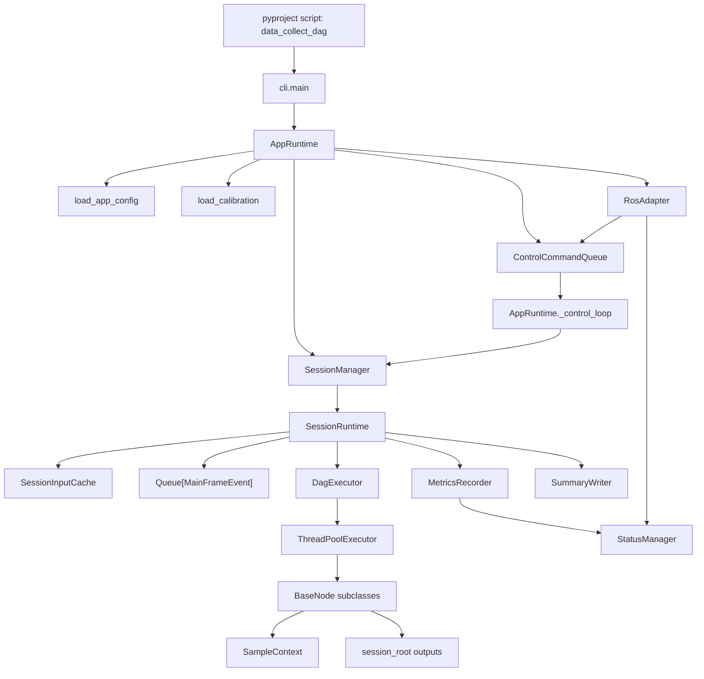
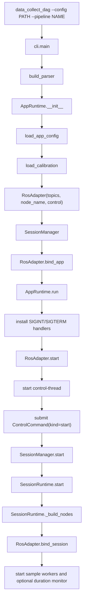
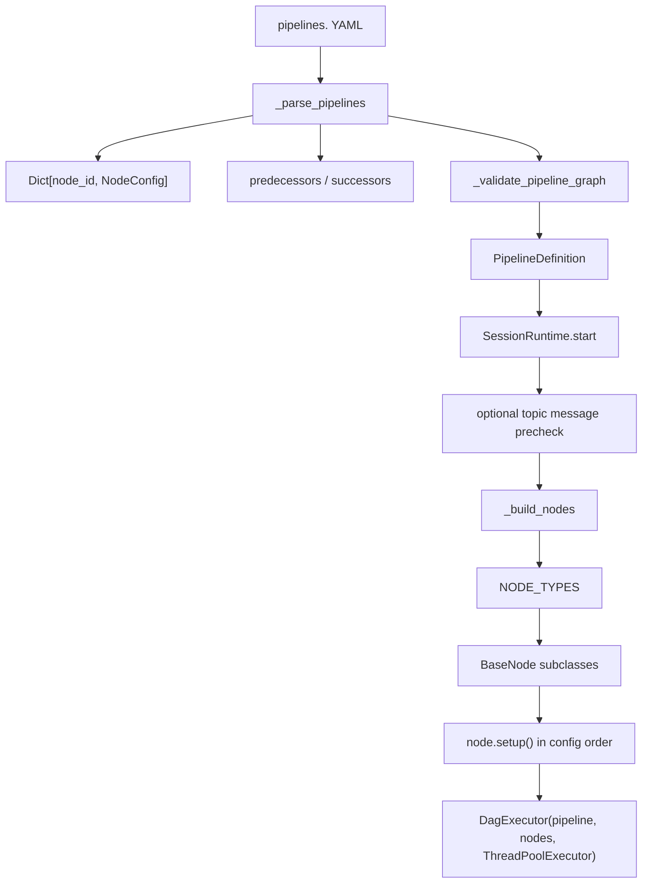
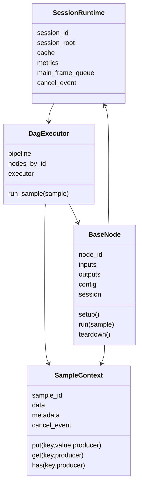
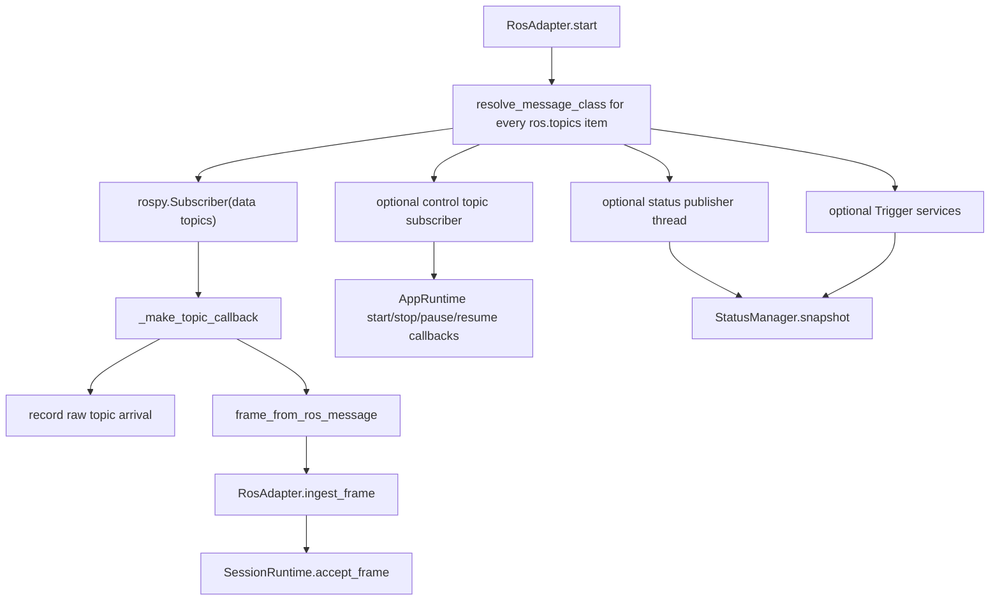
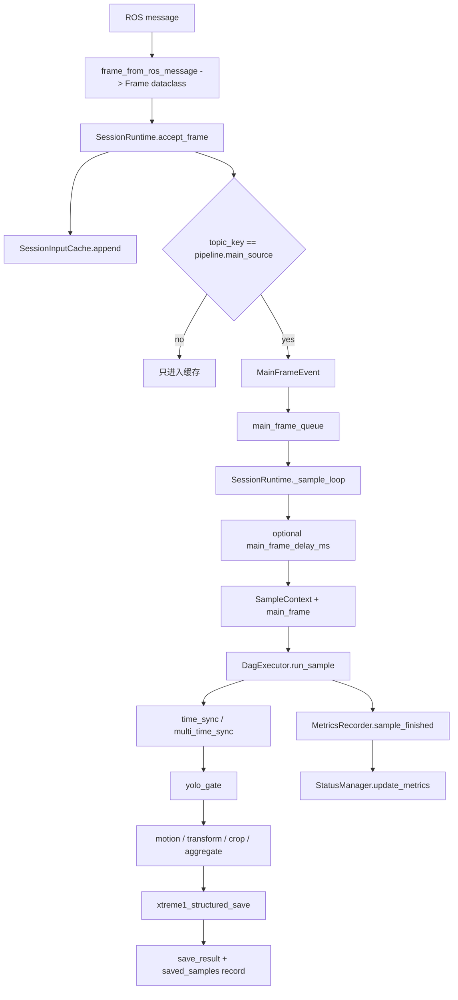
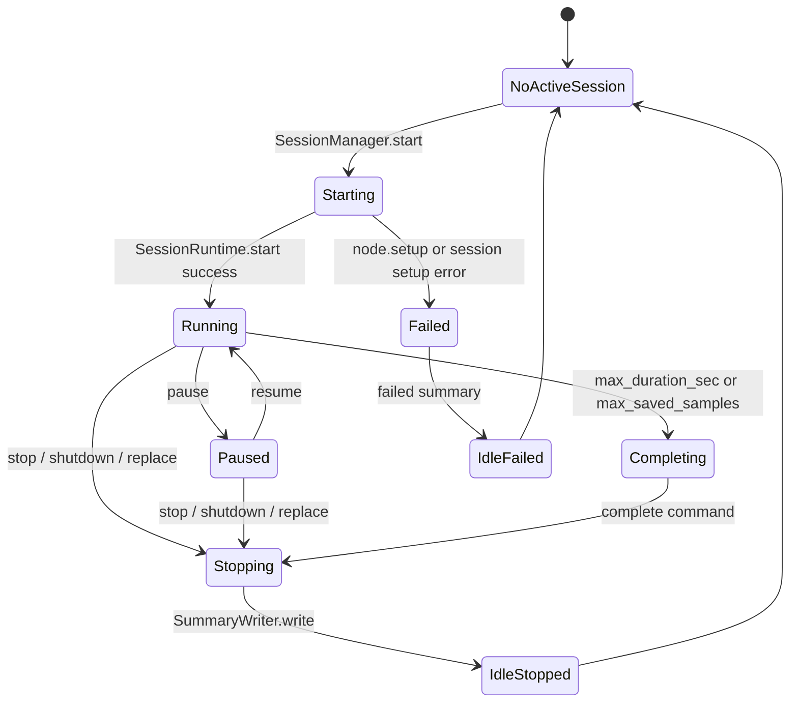

# DataCollectDAG 系统详细架构文档

## 1. 文档范围

本文档基于当前仓库中的代码、配置、测试和已有文档描述 DataCollectDAG 的实际实现。主要依据包括 `src/data_collect_dag/`、`src/data_collect_dag/nodes/`、`demo/xtreme1_demo.yaml`、`demo/calibration/sa1_cali.json`、`tests/unit/`、`tests/functional/`、`README.md`、`docs/requirements.md`、`pyproject.toml` 和 `setup.bash`。

本文档只记录当前代码能够确认的行为。需求文档中提出但代码尚未实现或未形成通用机制的内容，会在“当前实现边界”中明确说明。

不作为架构事实主要来源的目录包括 `__pycache__/`、`build/`、`dist/`、`output/` 和 `src/data_collect_dag.egg-info/`。

## 2. 系统定位

DataCollectDAG 当前实现为一个 ROS1 数据采集 DAG 运行时。它通过 CLI 指定 YAML 配置和 pipeline，启动 ROS adapter，订阅配置声明的 ROS topic，将 ROS message 包装为内部 frame 对象，按主帧触发样本级 DAG，执行同步、筛选、点云处理、聚合和保存节点，并在 session 结束时写出汇总文件。

事实依据：

| 结论 | 依据 |
|---|---|
| CLI 入口为 `data_collect_dag` | `pyproject.toml` `[project.scripts]` |
| CLI 调用 `data_collect_dag.cli:main` | `src/data_collect_dag/cli.py::main` |
| 应用运行时由 `AppRuntime` 负责 | `src/data_collect_dag/app.py::AppRuntime` |
| 单 session 运行和替换由 `SessionManager` 维护 | `src/data_collect_dag/session.py::SessionManager` |
| 样本级 DAG 由 `DagExecutor` 执行 | `src/data_collect_dag/dag.py::DagExecutor` |
| ROS topic 接入由 `RosAdapter` 完成 | `src/data_collect_dag/ros_adapter.py::RosAdapter` |

## 3. 仓库结构

```text
src/data_collect_dag/
  app.py                 应用入口运行时、控制循环、信号处理
  cli.py                 CLI main
  __main__.py            python -m data_collect_dag 入口
  config.py              YAML 配置解析和校验
  models.py              配置、frame、状态、指标、summary 数据结构
  session.py             SessionManager、SessionRuntime、节点注册表
  dag.py                 样本级 DAG 调度器
  ros_adapter.py         ROS topic/service/status 接入
  ros_messages.py        ROS message 解析、动态类型解析、内部 frame 包装
  ros_env.py             ROS Python path 和 msg 文件定位
  cache.py               SessionInputCache
  sample_context.py      SampleContext
  metrics.py             MetricsRecorder
  status.py              StatusManager
  summary.py             SummaryWriter
  io_utils.py            JSON/JPG/PCD 输出工具
  transforms.py          点云和姿态变换工具
  control.py             ControlCommandQueue
  nodes/
    base.py              BaseNode
    common.py            start/end、同步、点云处理、聚合节点
    vision.py            YOLO gate 节点
    xtreme1.py           Xtreme1 结构化保存节点

demo/
  xtreme1_demo.yaml      当前 demo pipeline、ROS topics、cache、runtime 配置
  calibration/           demo 标定文件
  models/README.md       YOLO 模型文件手工准备说明

tests/unit/              配置、缓存、ROS wrapper、节点、状态、session 局部行为测试
tests/functional/        session manager 启停替换测试
docs/                    需求和架构文档
```

`setup.bash` 是安装辅助脚本，按 `gpu|cpu|arm` 模式安装 `rospkg`、`ultralytics` 或 Jetson torch/torchvision wheel，然后执行 `pip install -e .`。项目元数据在 `pyproject.toml` 中声明 Python 版本为 `>=3.8,<3.9`。

## 4. 总体架构



当前实现的核心分层如下：

| 层级 | 主要模块 | 责任 |
|---|---|---|
| 启动和控制 | `cli.py`、`app.py`、`control.py` | 解析 CLI、加载配置、启动 ROS、串行分发控制命令、处理信号 |
| 配置和模型 | `config.py`、`models.py` | 解析 YAML、生成配置 dataclass、校验 pipeline graph 和部分节点配置 |
| ROS 适配 | `ros_adapter.py`、`ros_messages.py`、`ros_env.py` | 解析 ROS message 类型、订阅 topic、包装 frame、发布/查询状态、接收控制 |
| Session 运行 | `session.py` | 创建输出目录、构建节点、维护缓存/队列/线程池/指标/summary |
| DAG 执行 | `dag.py` | 根据 `PipelineDefinition` 的 predecessor/successor 关系调度节点 |
| 节点处理 | `nodes/*.py` | 同步、YOLO 筛选、点云处理、聚合和保存 |
| 输出和汇总 | `io_utils.py`、`summary.py`、`metrics.py`、`status.py` | 写 JSON/JPG/PCD、统计指标、生成状态快照和 session summary |

## 5. 系统入口

命令入口来自 `pyproject.toml`：

```text
data_collect_dag = "data_collect_dag.cli:main"
```

真实调用链为：

1. `data_collect_dag.cli:main` 创建 parser 并解析 `--config`、`--pipeline`。
2. `main()` 创建 `AppRuntime(config_path=args.config, pipeline_name=args.pipeline)`。
3. `main()` 调用 `runtime.run()` 并返回退出码。

`python -m data_collect_dag` 入口由 `src/data_collect_dag/__main__.py` 提供，测试 `tests/unit/test_module_entrypoint.py` 验证它会调用 `cli.main()` 并以 `SystemExit` 返回其退出码。

## 6. 启动与初始化流程



`AppRuntime.__init__` 会立即加载 YAML 配置和标定文件；如果 `calibration.path` 缺失，会抛出 `ValueError("calibration.path is required")`。`AppRuntime.run()` 先启动 ROS adapter，再启动控制线程，最后投递第一个 start 命令。第一个 start 与后续 ROS start 命令使用相同的异常边界：失败时记录 `last_error`，但控制线程、ROS adapter 和进程继续运行并等待后续命令；后续 start 成功时清空旧的 `last_error`。

事实依据：`src/data_collect_dag/app.py::AppRuntime.__init__`、`src/data_collect_dag/app.py::AppRuntime.run`、`src/data_collect_dag/session.py::SessionManager.start`、`src/data_collect_dag/session.py::SessionRuntime.start`。

## 7. 配置机制

配置入口是 `src/data_collect_dag/config.py::load_app_config`。它使用 `yaml.safe_load` 读取 YAML，并生成 `models.py` 中的 `AppConfig`、`TopicConfig`、`CachePolicy`、`RuntimeConfig`、`ControlConfig`、`PipelineDefinition`、`NodeConfig` 和 `StopConditions`。

当前支持的顶层结构来自代码和 demo 配置：

```yaml
output:
  root_dir: ./output
calibration:
  path: demo/calibration/sa1_cali.json
ros:
  node_name: data_collect_dag
  control:
    control_topic: /data_collect/control
    status_topic: /data_collect/status
    start_service: ...
    stop_service: ...
    status_service: ...
  topics:
    topic_key:
      topic: /ros/topic
      msg_type: package/Message
      role: image|pointcloud|imu|odometry|nmea|localization
      sensor_name: optional_name
cache:
  defaults_by_role:
    role:
      max_frames: 10
      max_age_sec: 1.0
  topic_overrides:
    topic_key:
      max_frames: 5
      max_age_sec: 1.0
runtime:
  debug: false
  sample_workers: 1
  node_workers: 4
  main_frame_queue_size: 20
  main_frame_delay_ms: 0
  stop_timeout_sec: 5.0
pipelines:
  pipeline_name:
    main_source: topic_key
    topics: [topic_key_a, topic_key_b]
    time_delay_ms: 1000
    stop_conditions:
      max_duration_sec: 600
      max_saved_samples: 1000
    nodes:
      - node_id: start
        type: start
        inputs: {}
        outputs: {}
        config: {}
    edges:
      - [start, end]
```

默认值来源：

| 字段 | 默认值 | 依据 |
|---|---:|---|
| `output.root_dir` | `output` | `load_app_config` |
| `ros.node_name` | `data_collect_dag` | `load_app_config` |
| `runtime.debug` | `False` | `RuntimeConfig` 构造 |
| `runtime.sample_workers` | `1` | `load_app_config` |
| `runtime.node_workers` | `4` | `load_app_config` |
| `runtime.main_frame_queue_size` | `20` | `load_app_config` |
| `runtime.main_frame_delay_ms` | `0` | `load_app_config` |
| `runtime.stop_timeout_sec` | `5.0` | `load_app_config` |
| `PipelineDefinition.topics` | `[]`（跳过启动前 topic 检查） | `_parse_pipeline_topic_precheck` |
| `PipelineDefinition.time_delay_ms` | `None` | `_parse_pipeline_topic_precheck` |
| `NodeConfig.inputs`、`outputs`、`config` | `{}` | `_parse_pipelines` |
| `TopicConfig.sensor_name` | `topic_key` | `_parse_topics` |

配置校验包括：

1. 根对象必须是 mapping。
2. `ros.control` 必须是 mapping；只接受 `control_topic`、`status_topic`、`start_service`、`stop_service`、`status_service`。
3. `ros.control` 中的未知字段会触发 `ConfigError`。
4. `ros.topics` 必须非空，每个 topic 必须包含 `topic`、`msg_type`、`role`。
5. 每个 topic 必须从 `cache.defaults_by_role` 和 `cache.topic_overrides` 合并出 `max_frames` 和 `max_age_sec`。
6. `runtime.sample_workers`、`runtime.node_workers`、`runtime.main_frame_queue_size` 必须大于等于 1；`runtime.stop_timeout_sec` 必须大于 0。
7. `pipelines` 必须非空。
8. 每个 pipeline 的 `main_source` 必须存在于 `ros.topics`。
9. `node_id` 不能重复。
10. edge 两端必须引用已声明节点。
11. 每个 pipeline 必须恰好有一个 `type: start` 节点和一个 `type: end` 节点。
12. graph 必须无环，所有节点必须从 start 可达，并且都能到达 end。
13. `time_sync.source`、`multi_time_sync.sources`、`pointcloud_motion_compensation.localization_source` 必须引用已声明 topic。
14. `fps_guard` 和 `fps_marker` 必须配置非空 `gate_id`；`fps_guard.max_fps` 必须存在且大于 0。
15. `yolo_gate` 必须配置 `model_path`、`image` 输入、`class_names`、`confidence_thresholds`、`min_area_ratios`、`predict_conf`；三个数组长度必须一致，阈值范围为 `[0, 1]`，且 `predict_conf <= min(confidence_thresholds)`；`failure_policy` 当前只接受 `skip_sample`。
16. pipeline 配置 `topics` 时必须是由 `ros.topics` key 构成的非空、无重复列表，并同时配置正整数 `time_delay_ms`；两个字段都不配置时跳过前置检查。
17. `stop_conditions.max_duration_sec` 和 `max_saved_samples` 如配置，必须大于 0。

当前配置解析不会在 `load_app_config` 阶段验证所有节点类型是否存在于 `NODE_TYPES`。未知节点类型会在 `SessionRuntime._build_nodes()` 通过 `NODE_TYPES[node_config.node_type]` 暴露为运行期错误。

## 8. DAG 构建机制



`NODE_TYPES` 位于 `src/data_collect_dag/session.py`，当前映射如下：

| `type` | 类 |
|---|---|
| `start` | `StartNode` |
| `end` | `EndNode` |
| `fps_guard` | `FpsGuardNode` |
| `fps_marker` | `FpsMarkerNode` |
| `time_sync` | `TimeSyncNode` |
| `multi_time_sync` | `MultiTimeSyncNode` |
| `localization_range` | `LocalizationRangeNode` |
| `pointcloud_radius_crop` | `PointCloudRadiusCropNode` |
| `pointcloud_motion_compensation` | `PointCloudMotionCompensationNode` |
| `pointcloud_transform` | `PointCloudTransformNode` |
| `pointcloud_roi_crop` | `PointCloudRoiCropNode` |
| `aggregate_pointclouds` | `AggregatePointCloudNode` |
| `yolo_gate` | `YoloGateNode` |
| `xtreme1_structured_save` | `Xtreme1SaveNode` |

构建时 `SessionRuntime._build_nodes()` 创建 `ThreadPoolExecutor(max_workers=runtime.node_workers)`，按 `pipeline.nodes_by_id.values()` 遍历节点配置，实例化节点，调用 `node.setup()`，然后创建 `DagExecutor`。由于 `nodes_by_id` 来自 YAML 节点列表的插入顺序，setup 顺序与配置中的节点声明顺序一致。

## 9. DAG 运行机制

`DagExecutor.run_sample(sample)` 的执行语义：

1. 初始 ready 列表只包含 `pipeline.start_node_id`。
2. ready 节点提交到 session 共享的 `ThreadPoolExecutor`。
3. 任一 future 完成后读取 `NodeOutcome`；节点抛出的异常被转换为 `NodeOutcome(status=FAIL_SAMPLE, reason="<node_id>: <exception>")`。
4. 节点耗时写入 `sample.metadata["node_timings_ms"][node_id]`。
5. 节点返回的 `warnings` 追加到 `sample.metadata["node_warnings"]`。
6. 节点返回的 `metadata` 写入 `sample.metadata["node_metadata"][node_id]`。
7. 只有当前节点返回 `OK` 后，且某后继的所有前驱均已完成并返回 `OK`，该后继才会进入 ready。
8. 任一节点返回非 `OK` 后，执行器停止提交新的 ready 节点，并设置 `sample.cancel_event`。
9. 已经提交的 future 不会被强制取消，执行器会等待已提交节点返回。

当前 `NodeResult` 枚举包含 `OK`、`SKIP_SAMPLE`、`FAIL_SAMPLE`、`FAIL_SESSION` 和 `CANCEL_SESSION`。通用 DAG 执行器当前不会把 `FAIL_SESSION` 或 `CANCEL_SESSION` 转换为 session 级停止命令；它们只参与 `MetricsRecorder.sample_finished()` 的统计分支。

## 10. 节点机制

所有节点继承 `src/data_collect_dag/nodes/base.py::BaseNode`。构造时注入 `NodeConfig` 和当前 session，并把以下字段保存为实例属性：

```text
node_id
node_type
inputs
outputs
config
session
logger
```

统一生命周期接口：

```text
setup()
run(sample)
teardown()
```

节点通过 `SampleContext` 读取输入和写出输出。`inputs` 把节点内部输入名映射到 `SampleContext` key，`outputs` 把节点内部输出名映射到 `SampleContext` key。节点通过 `self.session` 访问 cache、标定、metrics、session_root、app_config 等 session 级资源。

`SampleContext` 是线程安全容器，内部结构是 `data[key][producer] = value`。如果 `get(key)` 未指定 producer 且同一个 key 有多个 producer，会抛出 `AmbiguousContextKeyError`。这由 `src/data_collect_dag/sample_context.py::SampleContext` 和 `tests/unit/test_sample_context.py` 验证。

节点失败处理当前由返回值决定：

| 返回状态 | DAG 行为 | 指标行为 |
|---|---|---|
| `OK` | 可继续推进后继节点 | `sample_finished` 不增加 skip/fail |
| `SKIP_SAMPLE` | 停止提交新节点，设置 sample cancel event | `samples_skipped += 1`，记录 `skip_reasons[reason]` |
| `FAIL_SAMPLE` | 停止提交新节点，设置 sample cancel event | `samples_failed += 1`，记录 `fail_reasons[reason]` |
| 节点异常 | 转换为 `FAIL_SAMPLE` | 记录 fail |

## 11. 节点分类及实现

### 11.1 控制节点

| 节点 | 行为 | 依据 |
|---|---|---|
| `StartNode` | `run()` 直接返回 `OK`；不写入主帧 | `nodes/common.py::StartNode` |
| `EndNode` | `run()` 直接返回 `OK` | `nodes/common.py::EndNode` |
| `FpsGuardNode` | 按 `gate_id` 读取最近一次 marker 时间戳；未到 `max_fps` 对应间隔时跳过样本 | `nodes/common.py::FpsGuardNode` |
| `FpsMarkerNode` | 样本保存链路完成后记录该 `gate_id` 的主帧时间戳 | `nodes/common.py::FpsMarkerNode` |

主帧不是由 `StartNode` 放入上下文，而是在 `SessionRuntime._sample_loop()` 创建 `SampleContext` 后写入 `sample.put("main_frame", event.main_frame, "main_source")`。

### 11.2 时间同步节点

| 节点 | 输入 | 输出 | 行为 |
|---|---|---|---|
| `TimeSyncNode` | `inputs["reference_frame"]` | `outputs["matched_frame"]` | 从 `SessionInputCache` 查询单个 source，支持 `nearest` 和 `latest_before`；required 缺失返回 `SKIP_SAMPLE`，非 required 缺失返回 `OK` 并带 warning |
| `MultiTimeSyncNode` | `inputs["reference_frame"]` | 每个 source 对应输出 key | 对多个 source 使用共享 wait deadline；required 缺失任一 source 时返回 `SKIP_SAMPLE` |
| `LocalizationRangeNode` | `inputs["reference_frame"]` | `outputs["matched_frames"]` | 按 reference timestamp 前后窗口从 cache 中查询 localization frame 列表；为空则 `SKIP_SAMPLE` |

`TimeSyncNode` 和 `MultiTimeSyncNode` 会记录 `sample.metadata["time_offsets_ms"][source]`，同步缺失会记录 `sample.metadata["missing_inputs"][source]`。

### 11.3 点云处理节点

| 节点 | 行为 |
|---|---|
| `PointCloudRadiusCropNode` | 解析点云后按 XY 平面半径 `max_radius_m` 裁剪，写 `pointcloud_processing` metadata；required 且裁剪后为空则跳过样本 |
| `PointCloudMotionCompensationNode` | setup 校验 `sensor_topic` 对应点云外参；运行时要求点级 timestamp，等待 localization 覆盖，插值轨迹，将点补偿到 reference frame 时间；缺少覆盖时按 required 决定 skip 或 warning |
| `PointCloudTransformNode` | setup 校验点云外参；使用 `sensor2base` 变换点云并把 `frame_name` 设为 `base` |
| `PointCloudRoiCropNode` | 在 base 坐标下按 `front_m`、`rear_m`、`side_m` 裁剪；required 且为空则跳过 |
| `AggregatePointCloudNode` | 聚合 required 和已存在 optional 点云，输出 `frame_name="base"` 的聚合点云；required 缺失或聚合为空则跳过 |

点云解析和变换依据：`ros_messages.py::ensure_pointcloud_frame_parsed`、`transforms.py::transform_points`、`nodes/common.py`。

### 11.4 图像筛选节点

`YoloGateNode` 位于 `src/data_collect_dag/nodes/vision.py`。`setup()` 校验模型文件存在，读取多类别 gate 配置，规范化 `device`，在非 `.engine` 模型且 device 需要 CUDA 时检查 `torch.cuda.is_available()`，然后加载 `ultralytics.YOLO`。

`run()` 解码输入图像，调用 YOLO predict，并用 `predict_conf` 控制候选检测阈值。最终按 `class_names` 中每个目标类别对应的 `confidence_thresholds` 和 `min_area_ratios` 判断是否通过；任一目标类别检测满足阈值即返回 `OK`。未检测到满足条件的目标、推理异常、缺失输入或图像解码失败时返回 `SKIP_SAMPLE`。该节点持有 `_model` 和 `_predict_lock`，是当前唯一维护推理模型状态的节点。

### 11.5 保存节点

`Xtreme1SaveNode` 位于 `src/data_collect_dag/nodes/xtreme1.py`。`setup()` 创建如下目录：

```text
<session_root>/xtreme1/<dataset_name>/
  camera_config/
  lidar_point_cloud_0/
  camera_image_0/
  camera_image_1/
  camera_image_2/
  camera_image_3/
  camera_image_4/
```

它会对当前 `CAMERA_TOPIC_ORDER` 中已配置的 topic 校验图像标定存在。`run()` 按 `config.required_inputs` 校验 required 输入，解码前视主图和点云，要求点云 `frame_name == "base"`，然后写：

1. 每个已存在可选图像输入的 JPG。
2. 聚合点云 ASCII PCD。
3. 包含 5 个相机配置项的 camera config JSON。
4. `sample.metadata["save_result"]`，包括 `saved`、`dataset_name`、`camera_config`、`images`、`saved_camera_topics`、`pointcloud`。

测试 `tests/unit/test_xtreme1_save_node.py` 验证了文件输出、可选图像缺失时仍写相机配置、非 base 点云返回 `FAIL_SAMPLE`。

## 12. 数据模型

主要 dataclass 位于 `src/data_collect_dag/models.py`：

| 对象 | 用途 |
|---|---|
| `AppConfig` | 完整应用配置 |
| `TopicConfig` | 单个 ROS topic 的 key、topic、msg_type、role、sensor_name |
| `CachePolicy` | 单 topic cache 的 `max_frames` 和 `max_age_sec` |
| `RuntimeConfig` | worker、队列、delay、stop timeout、debug 配置 |
| `ControlConfig` | ROS 控制 topic/service 名称 |
| `PipelineDefinition` | pipeline 名称、main_source、可选 topic 前置检查、节点、边、start/end、stop 条件 |
| `NodeConfig` | node_id、node_type、inputs、outputs、config |
| `FrameMeta` | topic、sensor、role、source/receive timestamp、frame_id |
| `ImageFrame` | 图像 frame，支持延迟解码 |
| `PointCloudFrame` | 点云 frame，支持延迟解析 |
| `ImuFrame` | IMU frame |
| `OdometryFrame` | odometry frame |
| `LocalizationFrame` | localization frame |
| `TextFrame` | NMEA 或文本 frame |
| `MainFrameEvent` | 主帧队列事件 |
| `NodeOutcome` | 节点返回状态、原因、warnings、metadata |
| `SessionMetrics` | session 统计 |
| `SessionSummary` | summary 文件内容 |
| `StatusSnapshot` | 对外状态快照 |

`ImageFrame.replace()` 和 `PointCloudFrame.replace()` 返回新的 dataclass 实例；当前节点通常不会原地修改 frame，而是创建新 frame 后写回 `SampleContext`。

## 13. 样本上下文



`SessionRuntime._sample_loop()` 为每个主帧事件创建 `SampleContext(sample_id=str(main_frame.meta.source_timestamp_ns), cancel_event=threading.Event())`，并写入：

```text
key = "main_frame"
producer = "main_source"
value = event.main_frame
```

之后所有节点共享同一个 `SampleContext`。节点输出通过 `sample.put(output_key, value, self.node_id)` 写入。metadata 当前被用于：

| metadata key | 写入方 |
|---|---|
| `time_offsets_ms` | `TimeSyncNode`、`MultiTimeSyncNode` |
| `missing_inputs` | 同步节点 |
| `pointcloud_processing` | 点云裁剪/变换节点 |
| `motion_compensation` | `PointCloudMotionCompensationNode` |
| `aggregated_pointcloud` | `AggregatePointCloudNode` |
| `save_result` | `Xtreme1SaveNode` |
| `node_timings_ms` | `DagExecutor` |
| `node_warnings` | `DagExecutor` |
| `node_metadata` | `DagExecutor` |

## 14. ROS 接入机制



`RosAdapter.start()` 会先解析所有配置 topic 的 ROS message class。任一 topic 解析失败时，会在建立 subscriber 之前抛出 `RuntimeError`，错误信息列出失败的 `topic_key`、ROS topic 和 `msg_type`，并提示 source ROS workspace。该行为由 `tests/unit/test_ros_adapter.py` 覆盖。

每个数据 topic callback 在 frame 转换前通过 condition 保护的计数器记录原始消息到达。`wait_for_topic_messages()` 在调用时快照指定 topic 的计数，并在共享的 `time_delay_ms` deadline 内等待每个计数至少增加一次；因此历史消息不计入本次 pipeline start，而转换失败的消息仍能证明 topic 有流量。

消息类型解析路径：

1. `ros_messages.py::resolve_message_class` 先调用 `roslib.message.get_message_class(msg_type)`。
2. 如果失败，则通过 `genpy.dynamic.generate_dynamic` 和 msg 文件文本生成动态 message class。
3. msg 文件定位由 `ros_env.py::resolve_message_definition_path` 完成，优先查 `/opt/ros/noetic/share`，再通过 `rospkg.RosPack().get_path(package)` 查自定义 package。

`frame_from_ros_message()` 当前按 `TopicConfig.role` 包装 frame，而不是按 `msg_type` 自动推断：

| role | 内部对象 | 时间戳来源 |
|---|---|---|
| `image` | `ImageFrame` | `msg.header.stamp` |
| `pointcloud` | `PointCloudFrame` | `msg.header.stamp` |
| `imu` | `ImuFrame` | `msg.header.stamp` |
| `odometry` | `OdometryFrame` | `msg.header.stamp` |
| `localization` | `LocalizationFrame` | 优先 `msg.timestamp`，否则 `msg.header.stamp` |
| `nmea` | `TextFrame` | `msg.header.stamp` |

图像和点云是延迟解析：callback 阶段只保存 `raw_msg_ref` 和元数据，节点调用 `ensure_image_frame_decoded()` 或 `ensure_pointcloud_frame_parsed()` 时才解析。当前图像解析支持 `bgr8`、`rgb8`、`bgra8`、`rgba8`、`mono8`、`bayer_rggb8` 等 `sensor_msgs/Image` 风格字段；`sensor_msgs/CompressedImage` 未在当前包装和解码路径中形成已验证的通用支持。

## 15. 数据缓存与时间同步

`SessionInputCache` 是 session 级缓存，按 `topic_key` 分桶保存 `CachedFrame`。写入和查询均受锁保护。

缓存写入逻辑：

1. `SessionRuntime.accept_frame()` 先检查 session 是否 active、未 cancel、accepting frames、未 pause、未 completion requested。
2. 通过后调用 `metrics.received_message(topic_key)`。
3. 调用 `cache.append(topic_key, frame)`。
4. `append()` 按 receive timestamp 清理超龄数据，原因是 `cache_age_expired`。
5. `append()` 追加新 frame 后按 `max_frames` 清理最旧 frame，原因是 `cache_max_frames`。
6. drop 原因通过 `MetricsRecorder.cache_dropped()` 写入统计。

查询接口：

| 方法 | 语义 |
|---|---|
| `query_nearest(topic_key, timestamp_ns, max_time_diff_ms)` | 查 source timestamp 最接近且时间差不超过阈值的 frame |
| `query_latest_before(topic_key, timestamp_ns, max_age_sec)` | 查不晚于目标时间且不早于 `timestamp_ns - max_age_sec` 的最新 frame |
| `query_range(topic_key, start_time_ns, end_time_ns)` | 查闭区间内所有 frame |
| `wait_nearest(topic_key, timestamp_ns, max_time_diff_ms, timeout_ms)` | 循环等待 nearest 匹配或超时 |

`TimeSyncNode` 和 `MultiTimeSyncNode` 通过这些接口执行时间同步。`MultiTimeSyncNode` 对所有 source 共享一个 deadline，测试 `tests/unit/test_multi_time_sync_node.py` 验证后续 source 的 timeout 会扣除前序等待耗时。

## 16. 数据处理流程



demo pipeline `xtreme1_collect` 的主要处理链来自 `demo/xtreme1_demo.yaml`：

1. `front_wide_camera` 是 `main_source`。
2. `fps_control_guard` 按 `saved_sample_fps` 限制保存样本频率。
3. `front_yolo_gate` 对主图做 YOLO 多类别 gate。
4. `sync_top_lidar` 同步顶置激光雷达。
5. `sync_corner_lidars` 同步四个角雷达。
6. `sync_fisheye_images` 同步四个鱼眼相机。
7. 每路雷达做 motion compensation 和 transform to base。
8. `aggregate_pointclouds` 聚合 base 点云。
9. `save_xtreme1` 保存图片、聚合点云和相机配置。
10. `fps_control_marker` 在保存链路后记录主帧时间戳。
11. `end` 结束样本 DAG。

当前 demo graph 在 gate 后分为 lidar 和 fisheye 两支，保存节点依赖 `sync_fisheye_images` 和 `aggregate_pointclouds`，因此只有两支都完成后才会运行保存节点。

## 17. 控制流程

所有控制命令都进入 `ControlCommandQueue`，再由 `AppRuntime._control_loop()` 串行处理。当前命令类型：

| kind | 产生方 | 行为 |
|---|---|---|
| `start` | 初始 CLI start、ROS control topic JSON start、ROS start service | 调用 `SessionManager.start(pipeline_name)` |
| `stop` | ROS control topic JSON stop、ROS stop service | 调用 `SessionManager.stop(reason, STOPPED)` |
| `pause` | ROS control topic JSON pause | 调用 `SessionManager.pause()` |
| `resume` | ROS control topic JSON resume | 调用 `SessionManager.resume()` |
| `complete` | session 内部 stop condition | 如果 session_id 仍是 active session，则以 `COMPLETED` stop |
| `shutdown` | SIGINT/SIGTERM | 以 `STOPPED` stop active session，并停止 app loop |

ROS control topic 使用单一 `std_msgs/String`，字符串内容是 JSON。`{"command":"start","pipeline":"<pipeline_name>"}` 启动指定 pipeline，`{"command":"pause"}`、`{"command":"resume"}`、`{"command":"stop"}` 分别暂停、恢复、停止当前任务。ROS start service 当前使用 `std_srvs/Trigger`，不能携带 pipeline 参数，只会触发默认 pipeline。stop/status service 也使用 `std_srvs/Trigger`。

`SessionManager.start()` 保证同一时刻最多一个 active session。若已有 active session，新 start 会先调用 `stop(reason="replaced_by_new_start", status=STOPPED)`，再创建新 session。功能测试 `tests/functional/test_session_and_cli.py` 验证了 start、replace、stop 会创建不同 session_id 并生成 session_root。

## 18. 会话生命周期



`SessionRuntime.start()`：

1. 创建 `session_root`，`exist_ok=False`。
2. 绑定 session 级 `debug.log` handler。
3. `_build_nodes()` 创建线程池、实例化节点并执行 setup。
4. 设置 `_active=True`、`_accepting_frames=True`、运行开始时间。
5. `StatusManager.set_running(session_id, pipeline.name, start_time)`。
6. `RosAdapter.bind_session(self)`。
7. 启动 `runtime.sample_workers` 个 sample worker。
8. 如配置 `stop_conditions.max_duration_sec`，启动 duration monitor thread。

`SessionRuntime.stop()`：

1. 设置 `_accepting_frames=False`、`_paused=False`、`_completion_requested=True`。
2. 累计 active elapsed time。
3. 设置 `cancel_event`。
4. `ros_adapter.unbind_session(self)`。
5. 向每个 worker 投递 `MainFrameEvent(main_frame=None)` sentinel。
6. 按 `runtime.stop_timeout_sec` join sample worker。
7. 按 `runtime.stop_timeout_sec` join duration thread。
8. 按逆序调用节点 `teardown()`。
9. `ThreadPoolExecutor.shutdown(wait=True)`。
10. 写 `saved_samples.json`。
11. 写 `session_summary.json`。
12. 更新 status 为 idle，并记录 recent session status。
13. 解绑 session log handler。

注意：`stop_timeout_sec` 当前只限制 worker 和 duration thread 的 join。节点线程池使用 `shutdown(wait=True)`，已提交节点如果长时间阻塞，stop 仍会等待它们自然返回。

## 19. 状态管理

`ToolState` 当前包含：

```text
IDLE
RUNNING
PAUSED
```

`RecentSessionStatus` 当前包含：

```text
STOPPED
COMPLETED
FAILED
```

`StatusManager` 持有一个 `StatusSnapshot`，通过 lock 更新和克隆。主要更新点：

| 更新点 | 行为 |
|---|---|
| `SessionRuntime.start()` | `set_running(session_id, pipeline, start_time)` |
| `SessionRuntime.pause()` | `set_paused()` |
| `SessionRuntime.resume()` | `set_resumed()` |
| `SessionRuntime.accept_frame()`、sample 结束、stop | `update_metrics(metrics)` |
| setup 失败或控制命令异常 | `set_last_error(message)` |
| `SessionRuntime.stop()` 或 setup 失败 | `set_idle(recent_status)` |

`StatusManager` 可接收 `disk_usage_path`。`AppRuntime` 当前传入 `app_config.output_root_dir`，因此对外状态中的 `disk_free_gb` 表示输出根目录所在文件系统的剩余空间，单位为十进制 GB，保留 2 位小数。若磁盘查询失败，该字段为 null。

`StatusSnapshot.to_dict()` 当前输出字段：

```text
tool_state
recent_session_status
current_session_id
current_pipeline_name
start_time
disk_free_gb
last_error
warnings
received_messages
main_frame_events
samples_saved
samples_skipped
samples_failed
samples_canceled
drop_reasons
skip_reasons
fail_reasons
```

ROS status topic 每 0.5 秒发布一次 JSON 字符串；status service 返回同一个 JSON 字符串。依据为 `src/data_collect_dag/ros_adapter.py::RosAdapter._status_loop` 和 `RosAdapter._handle_status_service`。

## 20. 指标与汇总

指标由 `MetricsRecorder` 维护，底层数据结构是 `SessionMetrics`。当前统计项：

```text
received_messages
cache_dropped_messages
main_frame_events
main_frame_events_dropped
samples_started
samples_saved
samples_skipped
samples_failed
samples_canceled
warnings
errors
drop_reasons
skip_reasons
fail_reasons
save_outputs
```

`SessionMetrics.to_dict()` 不包含 `save_outputs`，`SessionRuntime.stop()` 会把 `metrics.to_dict()` 放入 summary 的 `metrics` 字段，同时把 `metrics.save_outputs` 单独写入 summary 的 `save_outputs` 字段。

sample 统计口径：

1. worker 开始处理主帧时调用 `sample_started()`。
2. 样本结束时若 `sample.metadata["save_result"]["saved"]` 为 true，先追加 saved sample record，再调用 `sample_saved()`。
3. 随后调用 `sample_finished(outcome.status, outcome.reason)` 统计 skip/fail/cancel。
4. 因此当前框架以 `save_result.saved` 判断 saved，不要求样本最终 outcome 必须是 `OK`。

`saved_samples.json` 的单条 record 由 `SessionRuntime._append_sample_record()` 生成，包含 sample_id、主帧时间、顶置雷达时间偏移、保存的相机 topic、motion/pointcloud processing 标记、Xtreme1 路径和节点耗时。

## 21. 日志机制

`logging_utils.py` 提供：

1. `configure_logging(level)`：配置全局日志格式和 root level。
2. `attach_session_log_file(path)`：为 root logger 添加 session 级文件 handler。
3. `detach_handler(handler)`：移除并关闭 handler。

`AppRuntime.__init__` 会根据 `runtime.debug` 配置全局日志级别。`SessionRuntime.start()` 创建 `session_root/debug.log` 并挂载 session 文件日志。`SessionRuntime.stop()` 和 setup 失败路径都会解绑 handler。

当前日志用于记录 app start/stop、控制命令异常、session start/stop、主帧队列行为、节点调度和节点内部处理。日志文件是框架级输出之一，但具体日志内容不是稳定数据接口。

## 22. 输出与保存

框架级 session 输出位于：

```text
<output.root_dir>/<session_id>/
```

当前框架写出的文件：

| 文件 | 写入路径 | 写入条件 |
|---|---|---|
| `debug.log` | `SessionRuntime.start()` | session_root 创建成功后 |
| `saved_samples.json` | `SessionRuntime.stop()` | 正常 stop/complete/replaced/shutdown 路径 |
| `session_summary.json` | `SessionRuntime.stop()` 或 setup 失败路径 | session 结束或 setup 失败 |

Xtreme1 保存节点写出的业务文件位于：

```text
<session_root>/xtreme1/<dataset_name>/
  camera_config/<timestamp>.json
  lidar_point_cloud_0/<timestamp>.pcd
  camera_image_<index>/<timestamp>.jpg
```

底层输出工具：

| 函数 | 行为 |
|---|---|
| `write_json(path, payload)` | 创建父目录并写 UTF-8 JSON |
| `save_jpg(path, image_bgr, quality=95)` | 将 BGR ndarray 转 RGB 后用 PIL 保存 JPEG |
| `save_ascii_pcd(path, points_xyz)` | 写 ASCII PCD，字段为 x/y/z |

## 23. 异常和结束处理

当前异常传播规则：

| 场景 | 当前行为 |
|---|---|
| 配置解析错误 | `load_app_config` 抛出 `ConfigError` |
| `calibration.path` 缺失 | `AppRuntime.__init__` 抛出 `ValueError` |
| ROS message class 解析失败 | `RosAdapter.start()` 在订阅前抛出 `RuntimeError` |
| pipeline topic 前置检查超时 | start 失败，错误列出缺失 topic，写 FAILED/setup_failed summary，服务继续运行 |
| 任意 start 命令失败 | 记录异常和 `last_error`，服务继续运行并等待后续命令 |
| session setup 失败 | 已 setup 节点逆序 teardown，写 FAILED summary，status idle FAILED |
| ROS callback 包装或 ingest 异常 | 记录 exception，若有 active session 则 `metrics.error()` |
| 节点 run 抛异常 | `DagExecutor` 转换为 `FAIL_SAMPLE` |
| 节点返回 `SKIP_SAMPLE` | 当前样本停止推进，记录 skip |
| 节点返回 `FAIL_SAMPLE` | 当前样本停止推进，记录 fail |
| SIGINT/SIGTERM | 投递 shutdown，active session 以 STOPPED 结束 |
| 新 start 替换旧 session | 旧 session 以 `replaced_by_new_start` 和 STOPPED 结束 |
| `max_duration_sec` 或 `max_saved_samples` 达成 | session 投递 complete 命令，以 COMPLETED 结束 |

当前代码没有通用节点级 retry、on_error 配置、强制取消已运行 future、或将 `FAIL_SESSION` 自动升级为 session stop 的机制。

## 24. 命令行接口

CLI parser 位于 `src/data_collect_dag/app.py::build_parser`，当前只支持：

```bash
data_collect_dag --config demo/xtreme1_demo.yaml --pipeline xtreme1_collect
```

参数：

| 参数 | required | 类型 | 含义 |
|---|---|---|---|
| `--config` | yes | `pathlib.Path` | YAML 配置路径 |
| `--pipeline` | yes | string | 初始启动 pipeline 名称 |

运行 demo 还需要 ROS1 环境、配置中引用的自定义 message package、YOLO 模型文件和 rosbag 数据。README 中记录了三终端运行方式：先 `roscore`，再启动 `data_collect_dag`，最后 `rosbag play test_data.bag`。

## 25. 测试结构与覆盖范围

测试按 `tests/unit/` 和 `tests/functional/` 划分。当前主要覆盖：

| 测试文件 | 覆盖行为 |
|---|---|
| `tests/unit/test_config.py` | demo 配置加载、runtime 校验、YOLO 配置校验、stop condition 校验 |
| `tests/unit/test_cache.py` | nearest 查询、max_frames 淘汰 |
| `tests/unit/test_sample_context.py` | put/get/remove、producer 歧义 |
| `tests/unit/test_ros_messages.py` | image、pointcloud、localization、nmea frame 包装和延迟解析 |
| `tests/unit/test_ros_adapter.py` | ROS message type 解析失败时 fail-fast、统一 control topic 订阅和 JSON 命令分发 |
| `tests/unit/test_ros_env.py` | 标准和自定义 msg 文件定位错误报告 |
| `tests/unit/test_time_sync_node.py` | 单源同步匹配和 required 缺失 skip |
| `tests/unit/test_multi_time_sync_node.py` | 多源同步和共享 wait budget |
| `tests/unit/test_yolo_gate_node.py` | YOLO gate 多类别通过、跳过、推理失败、device 规范化、CUDA 校验、模型缺失 |
| `tests/unit/test_pointcloud_*_node.py` | 点云裁剪、变换、运动补偿、聚合 |
| `tests/unit/test_xtreme1_save_node.py` | Xtreme1 输出文件、可选图像缺失、点云 frame 校验 |
| `tests/unit/test_status_summary.py` | 状态快照更新、磁盘剩余空间字段和 summary JSON |
| `tests/unit/test_session_runtime.py` | 主帧队列 drop oldest、pause/resume、max duration/max saved completion |
| `tests/unit/test_control_queue.py` | 控制命令队列 |
| `tests/unit/test_module_entrypoint.py` | module entrypoint 调用 CLI main |
| `tests/functional/test_session_and_cli.py` | AppRuntime 配置加载后通过 SessionManager start/replace/stop |

测试多数使用 fake ROS/YOLO/session 对象验证实现行为，不要求真实 roscore、真实 rosbag 或真实 YOLO 权重。

## 26. 当前实现边界

以下内容当前不能描述为已实现的通用能力：

1. 不会自动扫描 ROS graph 或 rosbag 中的所有 topic；只订阅 `ros.topics` 中声明的 topic。
2. `sensor_msgs/CompressedImage` 没有在当前 image wrapper/decoder 中形成可确认的通用支持。
3. ROS start service 使用 `std_srvs/Trigger`，不能携带 pipeline 名称或运行参数。
4. `ControlCommand.params` 和 `SessionSummary.pipeline_params` 当前存在字段，但没有实际参数传递和使用逻辑。
5. `FAIL_SESSION`、`CANCEL_SESSION` 枚举存在，但 DAG 执行器没有通用 session 级控制流处理。
6. stop 不强制中断已提交节点 future，也不保证总耗时受 `stop_timeout_sec` 严格限制。
7. 当前没有通用 `on_error`、retry、条件分支表达式或插件式节点发现机制。
8. 当前没有结果发布 topic；ROS 对外发布的是状态 JSON。
9. `pyproject.toml` 当前未声明运行依赖列表；README 和 `setup.bash` 说明了 `ultralytics`、`rospkg` 等安装方式。
10. Xtreme1 输出结构是当前唯一落地的保存节点，不代表框架已实现多种通用导出格式。
11. demo 中的 YOLO 模型文件需要手工准备，仓库只提供 `demo/models/README.md`。

## 27. 关键文件索引

| 文件 | 关键对象或内容 |
|---|---|
| `pyproject.toml` | package metadata、Python 版本、CLI entry point |
| `README.md` | 安装、demo 运行、输出说明 |
| `docs/requirements.md` | 需求背景和目标，不直接作为实现事实 |
| `setup.bash` | 安装辅助脚本 |
| `demo/xtreme1_demo.yaml` | demo topic、cache、runtime、pipeline graph |
| `demo/calibration/sa1_cali.json` | 图像标定和点云 `sensor2base` 外参 |
| `src/data_collect_dag/cli.py` | CLI main |
| `src/data_collect_dag/app.py` | `AppRuntime`、`load_calibration`、`build_parser` |
| `src/data_collect_dag/config.py` | `load_app_config`、配置校验 |
| `src/data_collect_dag/models.py` | 所有主要 dataclass 和 enum |
| `src/data_collect_dag/session.py` | `NODE_TYPES`、`SessionRuntime`、`SessionManager` |
| `src/data_collect_dag/dag.py` | `DagExecutor.run_sample` |
| `src/data_collect_dag/ros_adapter.py` | ROS 订阅、控制、状态发布和 service |
| `src/data_collect_dag/ros_messages.py` | ROS message class 解析、frame 包装、图像/点云解析 |
| `src/data_collect_dag/ros_env.py` | ROS Python path 和 msg 文件查找 |
| `src/data_collect_dag/cache.py` | `SessionInputCache` |
| `src/data_collect_dag/sample_context.py` | `SampleContext` |
| `src/data_collect_dag/metrics.py` | `MetricsRecorder` |
| `src/data_collect_dag/status.py` | `StatusManager` |
| `src/data_collect_dag/summary.py` | `SummaryWriter` |
| `src/data_collect_dag/io_utils.py` | JSON/JPG/PCD 输出函数 |
| `src/data_collect_dag/transforms.py` | quaternion、slerp、坐标变换工具 |
| `src/data_collect_dag/nodes/base.py` | `BaseNode` |
| `src/data_collect_dag/nodes/common.py` | start/end、同步、点云、聚合节点 |
| `src/data_collect_dag/nodes/vision.py` | `YoloGateNode` |
| `src/data_collect_dag/nodes/xtreme1.py` | `Xtreme1SaveNode` |
