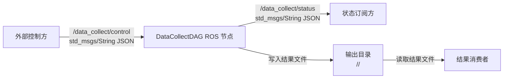
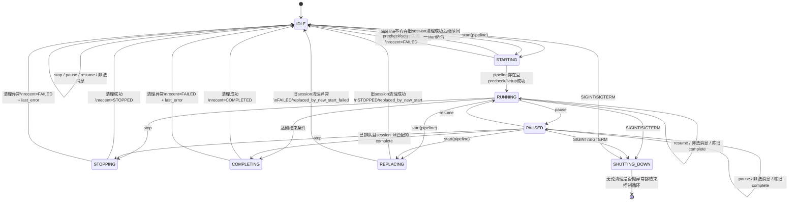
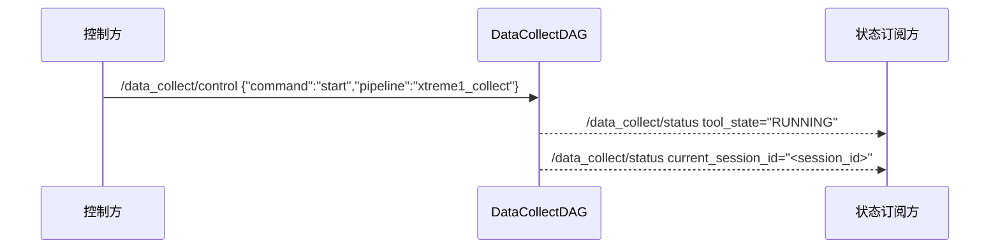
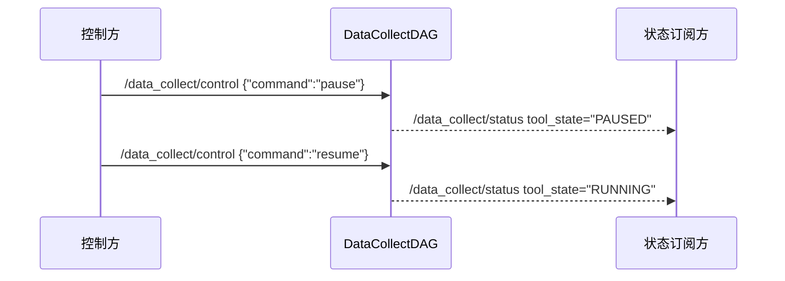
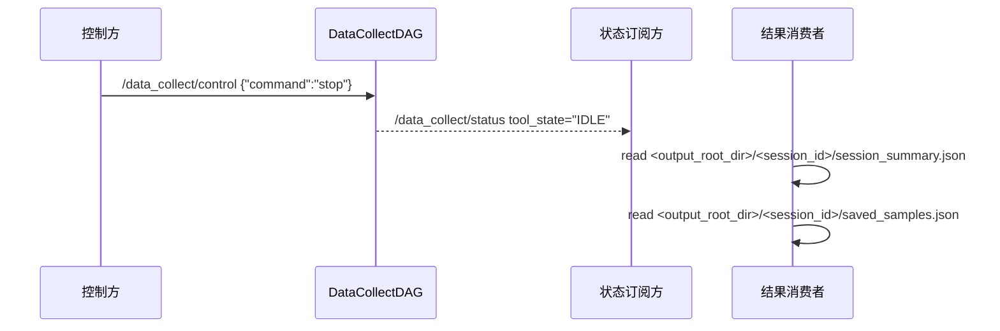
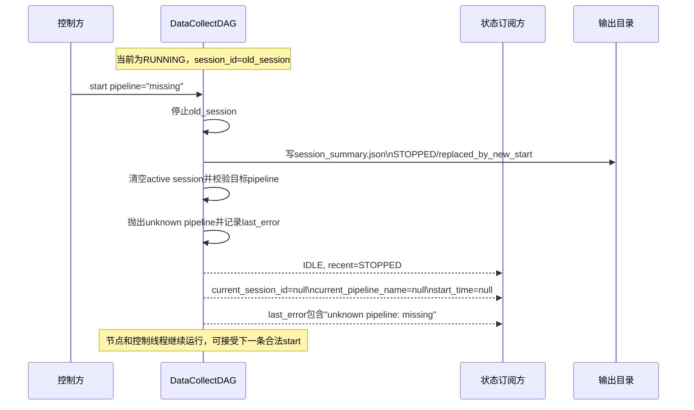
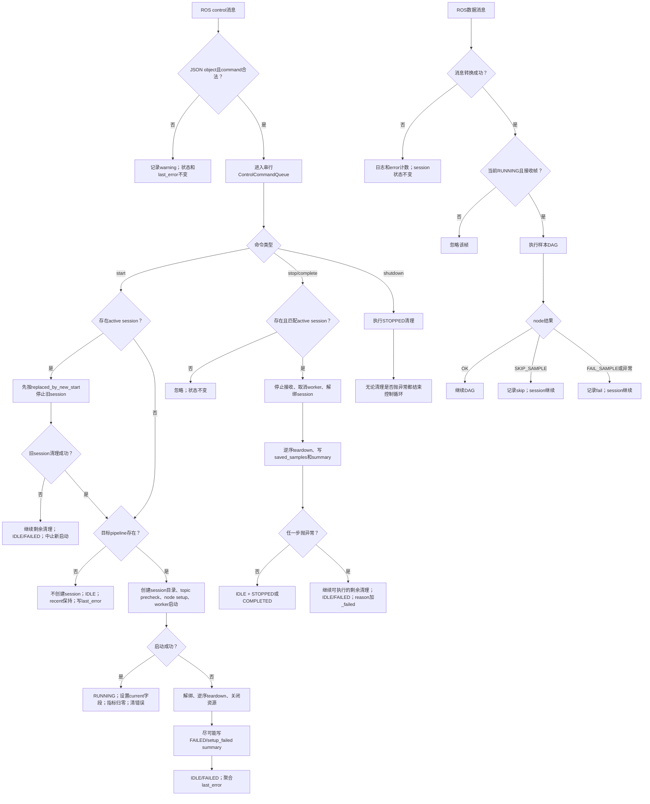

# DataCollectDAG 外部 ROS 系统架构说明

本文描述 DataCollectDAG 当前代码实现中的外部 ROS 对接方式。外部系统通过 ROS topic 控制任务、订阅任务状态，并在任务结束后读取输出目录中的结果文件。

## 1. 系统边界



| 角色 | 交互方式 | 说明 |
| --- | --- | --- |
| 外部控制方 | 发布 ROS topic | 下发 start、pause、resume、stop 控制命令 |
| 状态订阅方 | 订阅 ROS topic | 获取任务状态、session id、计数、错误和告警 |
| 结果消费者 | 读取文件系统 | 在任务结束后读取结果文件 |

DataCollectDAG 的 pipeline、ROS 输入 topic、缓存策略、运行参数和输出目录均由 YAML 配置加载。外部控制消息只能选择已加载配置中的 pipeline，不能动态创建或修改 pipeline。

## 2. 启动方式

当前 CLI 启动时需要指定配置文件和一个初始 pipeline：

```bash
data_collect_dag --config demo/xtreme1_demo.yaml --pipeline xtreme1_collect
```

运行时会启动 ROS adapter，并自动启动 CLI 参数指定的 pipeline。pipeline 可选配置 `topics` 和 `time_delay_ms`：每次 start 后，所有指定 topic 必须在该统一窗口内分别到达至少一条新消息，才会进入 DAG node setup；超时错误会在 `last_error` 中列出缺失 topic。该 start 与之后通过控制 topic 发送的 start 使用相同的错误处理：pipeline 名称、topic 前置检查或 setup 错误只会使当前命令失败，服务仍会继续接收控制命令；后续 start 成功后会清空旧的 `last_error`。如果在已有活动 session 时再次发送 `start`，当前 session 会先完整停止并写出 summary，然后才校验和启动目标 pipeline。因此目标 pipeline 不存在时，旧 session 仍以 `STOPPED/replaced_by_new_start` 结束，工具最终保持 `IDLE`。

## 3. ROS 配置

`demo/xtreme1_demo.yaml` 中当前配置如下：

```yaml
ros:
  node_name: data_collect_dag
  control:
    control_topic: /data_collect/control
    status_topic: /data_collect/status
```

| 配置字段 | 说明 |
| --- | --- |
| `ros.control.control_topic` | 配置后订阅该 topic 作为统一控制入口 |
| `ros.control.status_topic` | 配置后发布该 topic 作为状态出口 |
| `ros.control.start_service` | 可选 `std_srvs/Trigger` service；不能传 pipeline 参数 |
| `ros.control.stop_service` | 可选 `std_srvs/Trigger` service；停止当前 session |
| `ros.control.status_service` | 可选 `std_srvs/Trigger` service；返回一次 status JSON |

`ros.control` 只接受上表字段。未知字段会触发配置错误。

## 4. ROS Topic

| 方向 | Topic | 消息类型 | 说明 |
| --- | --- | --- | --- |
| 外部到本节点 | `/data_collect/control` | `std_msgs/String` | 控制任务 |
| 本节点到外部 | `/data_collect/status` | `std_msgs/String` | 发布状态 JSON |

控制 topic 和状态 topic 都使用 `std_msgs/String`。JSON 内容放在 `msg.data` 中。

## 5. 控制消息

Topic：

```text
/data_collect/control
```

消息类型：

```text
std_msgs/String
```

`msg.data` 必须是 JSON object 字符串。控制字段如下：

| 字段 | 类型 | 必填 | 说明 |
| --- | --- | --- | --- |
| `command` | string | 是 | `start`、`pause`、`resume`、`stop` 之一，必须小写 |
| `pipeline` | string | start 必填 | 要启动的 pipeline 名称 |

### 5.1 start

```json
{
  "command": "start",
  "pipeline": "xtreme1_collect"
}
```

行为：

1. `pipeline` 必须是非空字符串，代码会对两端空白做 `strip()`。
2. `pipeline` 必须存在于启动时加载的配置中。
3. 如果当前已有活动 session，会先停止当前 session，再启动新 session。
4. 旧 session 停止成功但目标 pipeline 不存在时，不会创建新 session；最终状态为 `IDLE`，`recent_session_status` 保持旧 session 的 `STOPPED`，`last_error` 记录 unknown pipeline。
5. 旧 session 清理失败时中止新启动；最终状态为 `IDLE/FAILED`，不会继续创建目标 session。

### 5.2 pause

```json
{
  "command": "pause"
}
```

行为：暂停当前活动 session。暂停后不再接收新帧，状态变为 `PAUSED`。没有活动 session 或当前状态不能暂停时，该命令不会改变状态。

### 5.3 resume

```json
{
  "command": "resume"
}
```

行为：恢复当前暂停的 session，状态变为 `RUNNING`。没有活动 session 或当前状态不能恢复时，该命令不会改变状态。

### 5.4 stop

```json
{
  "command": "stop"
}
```

行为：停止当前活动 session。停止后状态变为 `IDLE`，最近 session 状态为 `STOPPED`。没有活动 session 时，该命令不会改变状态。

### 5.5 非法控制消息

以下情况会被忽略并写入节点日志 warning：

| 情况 | 示例 |
| --- | --- |
| `msg.data` 不是 JSON object | `pause`、`["pause"]` |
| 缺少合法 `command` | `{}`、`{"command":"unknown"}` |
| `command` 大小写不匹配 | `{"command":"Start","pipeline":"xtreme1_collect"}` |
| start 缺少有效 pipeline | `{"command":"start"}`、`{"command":"start","pipeline":""}` |

非法控制消息不会直接修改当前任务状态，也不会直接写入 `last_error`。如果消息格式合法但执行失败，例如 pipeline 名称不存在，控制线程会记录异常，并通过 status 的 `last_error` 暴露错误文本。若执行失败前存在活动 session，start 的替换语义仍然生效：旧 session 先结束，随后工具停留在 `IDLE`。

## 6. 状态消息

Topic：

```text
/data_collect/status
```

消息类型：

```text
std_msgs/String
```

`msg.data` 为 JSON 字符串。示例：

```json
{
  "tool_state": "RUNNING",
  "recent_session_status": null,
  "current_session_id": "<session_id>",
  "current_pipeline_name": "xtreme1_collect",
  "start_time": "2026-07-31T10:30:12.123456",
  "disk_free_gb": 123.45,
  "last_error": null,
  "warnings": 0,
  "received_messages": {
    "front_wide_camera": 120
  },
  "main_frame_events": 120,
  "samples_saved": 18,
  "samples_skipped": 2,
  "samples_failed": 0,
  "samples_canceled": 0,
  "drop_reasons": {},
  "skip_reasons": {},
  "fail_reasons": {}
}
```

字段定义：

| 字段 | 类型 | 说明 |
| --- | --- | --- |
| `tool_state` | string | 当前状态：`IDLE`、`RUNNING`、`PAUSED` |
| `recent_session_status` | string 或 null | 最近结束 session 的状态：`STOPPED`、`COMPLETED`、`FAILED` |
| `current_session_id` | string 或 null | 当前活动 session id |
| `current_pipeline_name` | string 或 null | 当前活动 session 的 pipeline 名称 |
| `start_time` | string 或 null | 当前活动 session 的开始时间；`IDLE` 时为 null |
| `disk_free_gb` | number 或 null | `output.root_dir` 所在文件系统的当前剩余空间，单位 GB |
| `last_error` | string 或 null | 最近一次控制或运行错误 |
| `warnings` | number | warning 计数 |
| `received_messages` | object | 按 `topic_key` 统计的输入消息数量 |
| `main_frame_events` | number | 主输入帧触发的采样事件数量 |
| `samples_saved` | number | 已保存样本数量 |
| `samples_skipped` | number | 已跳过样本数量 |
| `samples_failed` | number | 失败样本数量 |
| `samples_canceled` | number | 取消样本数量 |
| `drop_reasons` | object | 丢弃原因计数 |
| `skip_reasons` | object | 跳过原因计数 |
| `fail_reasons` | object | 失败原因计数 |

发布规则：

| 项 | 当前实现 |
| --- | --- |
| 发布间隔 | 约 0.5 秒 |
| Publisher latch | `latch=True` |
| JSON 编码 | `json.dumps(..., ensure_ascii=False)` |

外部系统应以 status 作为控制命令是否生效的确认来源：

| 命令 | 确认条件 |
| --- | --- |
| start | `tool_state == "RUNNING"`，`current_pipeline_name` 等于目标 pipeline，`current_session_id != null` |
| pause | `tool_state == "PAUSED"`，`current_session_id != null` |
| resume | `tool_state == "RUNNING"`，`current_session_id != null` |
| stop | `tool_state == "IDLE"`，`recent_session_status == "STOPPED"` |

`recent_session_status` 表示最近一次结束状态，不等价于当前运行状态。判断当前是否有活动任务，应优先使用 `tool_state`、`current_session_id` 和 `current_pipeline_name`。

start 失败的确认条件：

| 场景 | 确认条件 |
| --- | --- |
| 目标 pipeline 不存在，且此前无活动 session | `tool_state == "IDLE"`、三个 current 字段为 null、`last_error != null`；`recent_session_status` 保持原值 |
| 目标 pipeline 不存在，且替换了活动 session | `tool_state == "IDLE"`、`recent_session_status == "STOPPED"`、三个 current 字段为 null、`last_error != null` |
| topic precheck 或 setup 失败 | `tool_state == "IDLE"`、`recent_session_status == "FAILED"`、三个 current 字段为 null、`last_error != null` |

新 session 成功进入 `RUNNING` 时，warning、消息、样本和原因计数全部归零。进入 `IDLE` 后，这些字段保留最近结束 session 的最终计数，直到下一次 start 成功。

### 6.1 状态转换

`STARTING`、`STOPPING`、`COMPLETING`、`REPLACING` 和 `SHUTTING_DOWN` 是内部处理阶段，不会作为 `tool_state` 发布。



## 7. 输出文件

任务结果通过文件系统交付。

输出目录：

```text
<output_root_dir>/<session_id>/
```

`<output_root_dir>` 来自配置中的 `output.root_dir`。`<session_id>` 来自运行中的 status `current_session_id`，或任务结束后的 `session_summary.json`。

当前 session 目录中的主要文件：

| 文件 | 说明 |
| --- | --- |
| `session_summary.json` | session 汇总 |
| `saved_samples.json` | 已保存样本索引，顶层结构为 `{"items": [...]}` |
| `debug.log` | 当前 session 日志 |
| 其他输出文件 | 由具体节点实现产生 |

`session_summary.json` 字段：

| 字段 | 说明 |
| --- | --- |
| `session_id` | session id |
| `pipeline_name` | pipeline 名称 |
| `start_time` | 开始时间 |
| `end_time` | 结束时间 |
| `end_status` | `STOPPED`、`COMPLETED` 或 `FAILED` |
| `end_reason` | 结束原因 |
| `config_path` | 本次启动加载的配置文件路径 |
| `session_root` | 本次任务输出目录 |
| `pipeline_params` | 当前代码写出空 object |
| `metrics` | 任务统计 |
| `save_outputs` | 保存输出路径列表 |
| `last_error` | session 内错误信息 |
| `warnings` | session 内 warning 列表 |

`saved_samples.json` 的 `items[]` 记录当前包含以下字段：

| 字段 | 说明 |
| --- | --- |
| `sample_id` | 样本 id，当前来自主帧时间戳 |
| `main_source_timestamp_ns` | 主输入帧时间戳 |
| `top_lidar_time_offset_ms` | top lidar 与参考时间的偏移 |
| `saved_camera_topics` | 已保存图片 topic 列表 |
| `motion_compensation_applied` | 是否执行运动补偿 |
| `motion_compensation_reference_time_ns` | 运动补偿参考时间戳 |
| `pointcloud_in_base` | 点云是否已转换到 base 坐标系 |
| `sensor_radius_crop_applied` | 是否执行 sensor 半径裁剪 |
| `base_roi_crop_applied` | 是否执行 base ROI 裁剪 |
| `xtreme1_paths` | Xtreme1 输出路径 |
| `node_timings_ms` | 节点耗时统计 |

读取规则：

1. 任务运行期间可以展示 `current_session_id`，但不要把输出文件视为完整结果。
2. 当 status 的 `tool_state` 变为 `IDLE` 后，再读取该 session 目录下的结果文件。
3. 外部系统应优先读取 `session_summary.json` 判断结束状态和结束原因。

## 8. 典型时序

### 8.1 启动任务



### 8.2 暂停和恢复



### 8.3 停止并读取结果



### 8.4 运行中启动不存在的 pipeline



### 8.5 错误处理



配置解析、标定加载、ROS master 连接和 ROS message class 解析发生在控制接口可用之前。这些进程启动错误无法通过 `/data_collect/status` 报告，只能通过进程退出和日志诊断。线程中永久不返回的 node 不在本错误恢复模型内；停止流程仍会等待已经运行的 node 返回。

## 9. rostopic 示例

启动指定 pipeline：

```bash
rostopic pub -1 /data_collect/control std_msgs/String "data: '{\"command\":\"start\",\"pipeline\":\"xtreme1_collect\"}'"
```

暂停：

```bash
rostopic pub -1 /data_collect/control std_msgs/String "data: '{\"command\":\"pause\"}'"
```

恢复：

```bash
rostopic pub -1 /data_collect/control std_msgs/String "data: '{\"command\":\"resume\"}'"
```

停止：

```bash
rostopic pub -1 /data_collect/control std_msgs/String "data: '{\"command\":\"stop\"}'"
```

订阅状态：

```bash
rostopic echo /data_collect/status
```

## 10. 对接要求

| 要求 | 说明 |
| --- | --- |
| 控制消息发布到 `/data_collect/control` | 使用 `std_msgs/String` |
| 控制内容使用 JSON object | JSON 放在 `msg.data` 中 |
| start 命令必须带 `pipeline` | pipeline 名称必须存在于启动配置中 |
| 状态从 `/data_collect/status` 订阅 | 解析 `msg.data` 中的 JSON |
| 控制后等待 status 确认 | 不以 publish 成功作为状态已改变的依据 |
| 允许 `disk_free_gb` 为 null | 磁盘查询失败时该字段为 null |
| 读取结果前等待 `IDLE` | 避免读取未完成输出 |
